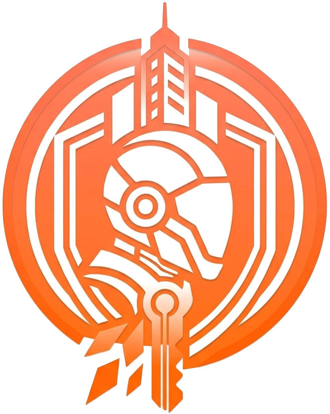

<p align="center">
  
</p>

<h1 align="center">ROOFTOP RUSH</h1>

<p align="center"><b>The city went dark. You've got the key to turn it back on. Don't stop running.</b></p>

Rooftop Rush is a free 3D rooftop runner for mobile and desktop. You are **Jane**, a courier from the Harbor Division, and you're carrying the **Lantern Key** across the skyline of Harbor City. Helix Corp wants the night all to itself. Your job is to leap the barriers, duck the drones and bring the lights back on.

🔗 **Live demo:** [Rooftop Rush](https://samanway-koley.github.io/rooftop-rush/)

  

---

## ✨ Features

- **Four story chapters** — Run Jane's route through Harbor City, starting with Chapter 1, "The Drop," where the goal is to reach the Signal Relay 700 m away.
- **Endless Night Shift** — No finish line, just a distance to beat. Your best run is saved on the menu so you always have a ghost to chase.
- **Three-lane rooftop dash** — Weave between lanes, vault barriers and slide under Helix drones without losing speed.
- **Hold-to-soar jumps** — Tap for a hop, hold for a leap. Reading the gap ahead is half the game.
- **Turbo dash** — Fill the turbo meter, then burn it for a burst of speed when the rooftops get crowded.
- **Coins, Lantern Shards and stars** — Grab them mid-run while a score multiplier rewards you for staying clean.
- **Mika on the radio** — Your dispatcher narrates the mission, so the story keeps pace with the run.
- **Chapter report cards** — Every finish shows distance, best score, coins, hits and time, then offers Retry or Next Chapter.
- **Pocket-ready** — Tap controls on mobile, keyboard on desktop, and an install prompt so Harbor City lives on your home screen.
- **Pause and sound controls** — Catch your breath mid-run, then restart or head back to the menu. Sound toggles on demand.

## 🖥️ How It Works

1. **Open the game.** A loading screen builds Harbor City while the 3D scene spins up.
2. **Pick your shift.** Choose **Story** for the chapters or **Endless** for the Night Shift.
3. **Tap or press `Space`.** Jane takes off across the rooftops.
4. **Read the skyline.** The world is drawn in real time with WebGL, and obstacles arrive in three lanes: barriers to jump and Helix drones to slide under.
5. **Collect as you go.** Coins, Lantern Shards and stars feed your score and your turbo meter.
6. **Hit turbo.** Spend the meter on a dash to clear tough stretches.
7. **Finish or fall.** Reach the chapter objective, or run until the night shift ends. Then check your stats and go again.

> 💡 **Dispatch tip:** Hold jump for a higher leap. Slide under Helix drones.

## ⌨️ Keyboard Shortcuts

| Key | Action |
|---|---|
| `←` / `→` | Switch lanes |
| `Space` | Start / jump (hold for a higher leap) |
| `↓` | Slide |
| `Shift` | Turbo dash |

On touch devices, tap the screen to run and use the on-screen controls.

## 🛠️ Tech Stack

| Layer | Technology |
|---|---|
| 3D rendering | [Three.js](https://threejs.org/) |
| Graphics API | [WebGL](https://www.khronos.org/webgl/) |
| App model | [Progressive Web App](https://web.dev/progressive-web-apps/) (installable) |
| Hosting | [GitHub Pages](https://pages.github.com/) |

## 🚀 Getting Started Locally

Rooftop Rush runs entirely in the browser, so all you need is a static file server.

```bash
# Clone the repository
git clone https://github.com/Samanway-Koley/rooftop-rush.git
cd rooftop-rush

# Serve the project folder with any static server
python3 -m http.server 8000
```

Open `http://localhost:8000` and start running.

> ⚠️ Serve the game over HTTP instead of double-clicking the HTML file. Browsers restrict WebGL asset loading and install/offline features on `file://` URLs.

## 🌐 Deployment

Rooftop Rush is deployed with GitHub Pages and lives at `https://samanway-koley.github.io/rooftop-rush/`.

## 🤝 Contributing

Contributions, bug reports, and feature requests are welcome!

1. Fork the repository
2. Create a feature branch: `git checkout -b feature/my-feature`
3. Commit your changes: `git commit -m "Add my feature"`
4. Push to the branch: `git push origin feature/my-feature`
5. Open a Pull Request

Please keep PRs focused and include a short description of the problem being solved.

## 👤 Author

**Samanway Koley**

- GitHub: [@Samanway-Koley](https://github.com/Samanway-Koley)
- LinkedIn: [Samanway Koley](https://www.linkedin.com/in/samanway-koley)
- Email: [samanway.koley@gmail.com](mailto:samanway.koley@gmail.com)

---

<p align="center">If you find this game useful, consider giving the repo a ⭐ — it helps others discover it.</p>
